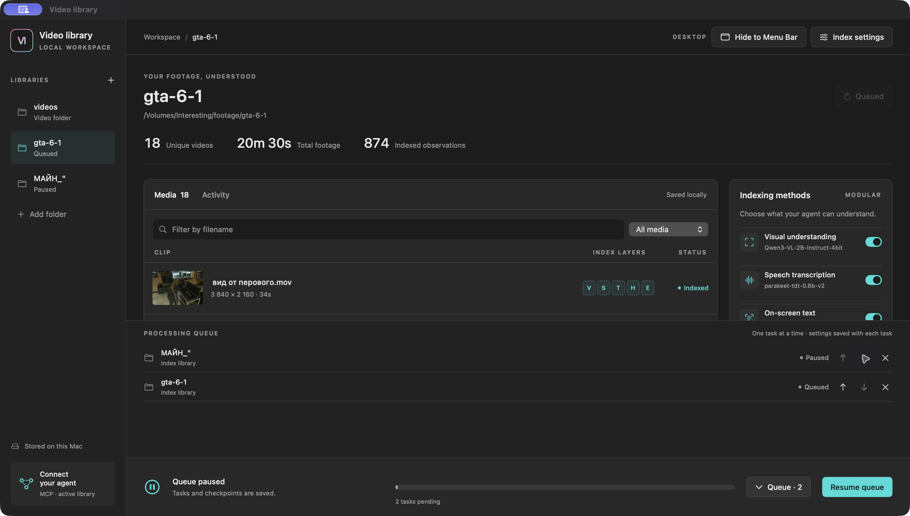
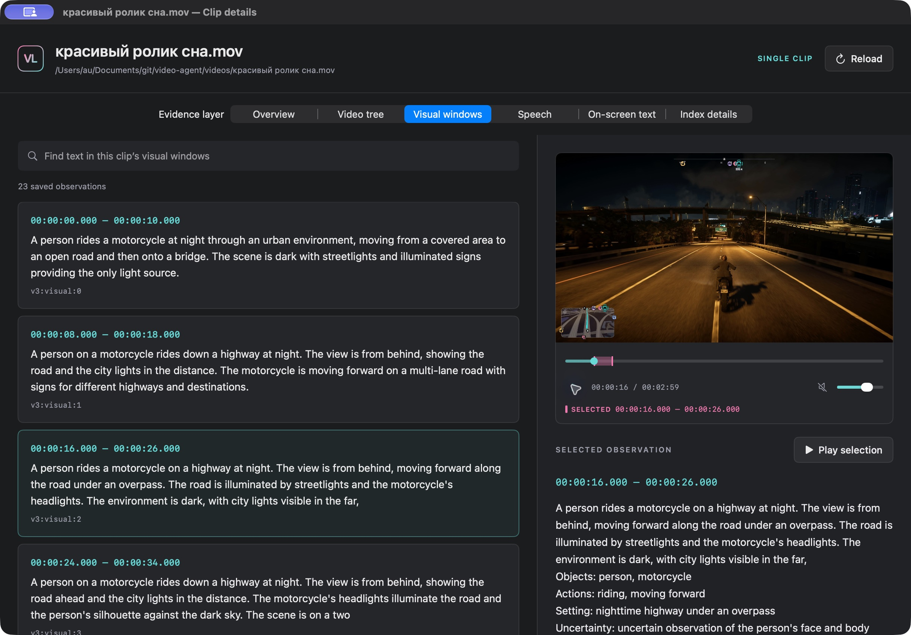

<p align="center">
  
</p>

<h1 align="center">Video library</h1>

<p align="center"><b>Find moments in your footage. Let your AI agent explore them.</b></p>
<p align="center">Early alpha · Apple Silicon · Python + SwiftUI · MCP</p>

Video library turns video folders into a searchable local index of scenes, speech
and on-screen text, with timestamps back to the original footage. Browse it in
the native Mac app or connect an AI agent through MCP. Your source videos stay unchanged.

<p align="center">
  
</p>
<p align="center"><sub>Library queue from an earlier development build. The interface is evolving.</sub></p>

<details>
<summary>Clip inspection and playback</summary>

<p align="center">
  
</p>
<p align="center"><sub>Inspect saved observations and jump to the source footage. Development screenshot.</sub></p>

</details>

## What it does

- Describes scenes, transcribes speech and recognizes on-screen text.
- Builds event trees and summaries; searches by exact words or meaning.
- Queues multiple folders, saves checkpoints and resumes unfinished work.
- Downloads and manages local models, with settings suggested for your Mac.
- Lets MCP agents choose a library, search observations and inspect source frames.

Local models process footage on your Mac. An optional visual API connection sends
sampled frames to the server you choose.

## Status

A working prototype in active development, tested on **Mac mini M4 / 16 GB**.
Installation is from source; there is no standalone installer yet.
AI observations can be inaccurate, and frame sampling can miss brief events.

## Get started

Requires **macOS 14+, Apple Silicon, Python 3.12, FFmpeg and Command Line Tools**.
From the project folder:

```bash
python3.12 -m venv .venv
source .venv/bin/activate
pip install -e '.[mac]'
python main.py ui
```

**Add folder → choose models → Download → Start indexing.** Models are not bundled.
To connect an agent, open **Connect your agent** in the app.

[Usage & MCP (Russian)](docs/USAGE.md) · [Development](docs/DEVELOPMENT.md) · [Historical validation report](BENCHMARKS.md)

## Credits & license

Built with **OpenAI Codex**. The author's rough estimate: **30% human, 70% Codex**.
Released under the [MIT License](LICENSE).
